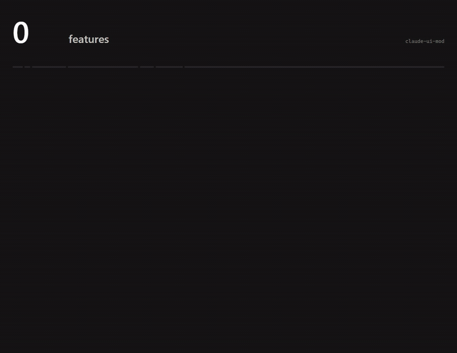
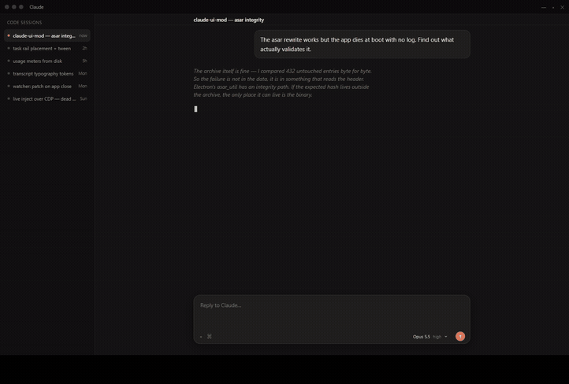
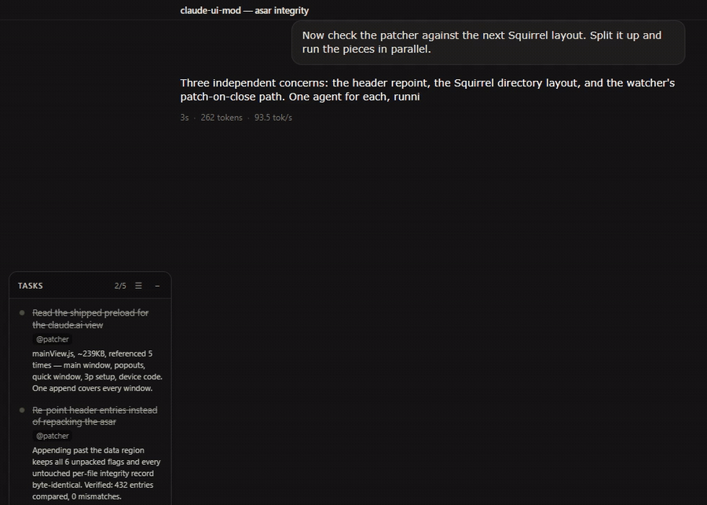
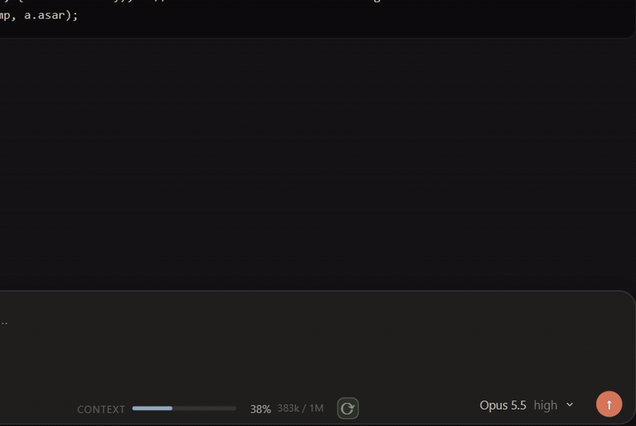
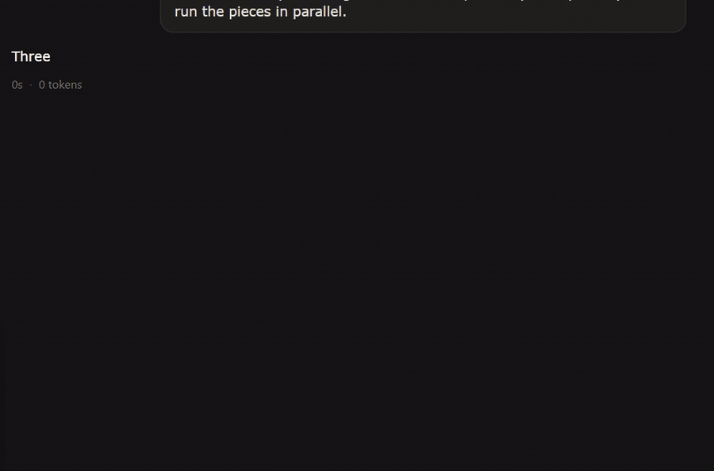
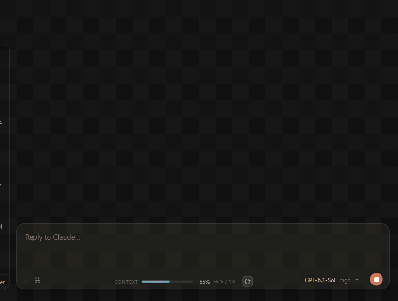
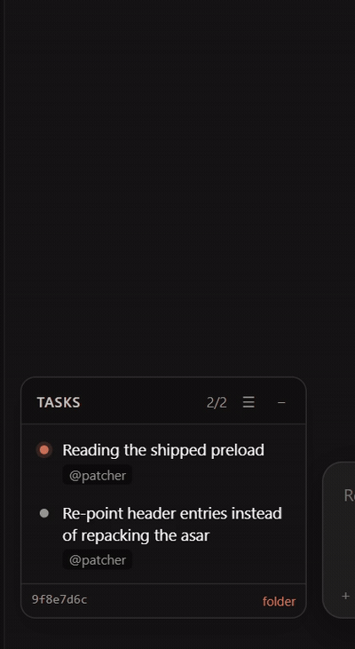
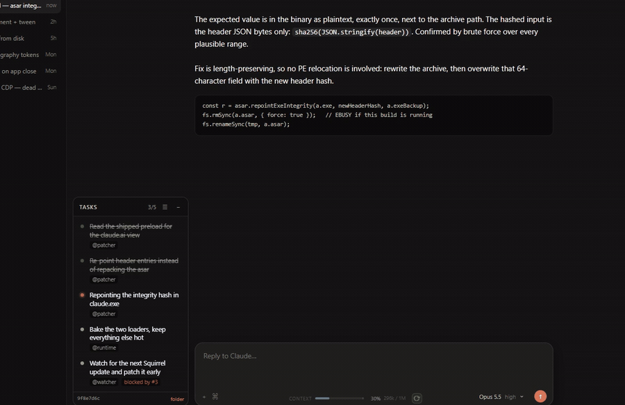
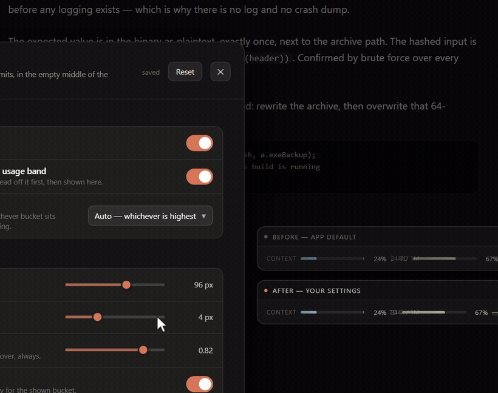

# claude-ui-mod

**A hot-reloadable plugin runtime for Claude Desktop on Windows: 33 plugins and
419 features in the box.** Model mixing across agents, a subagent HUD, task
rail, send queue, provider picker, per-response throughput, and fixes for
Claude Code Desktop bugs, injected into the app and editable while it runs: save
a file and the change is live, with no restart and no interruption to a Claude
Code session that is mid-turn.

**Mix models in one conversation.** Every agent picks its own provider: a
Claude Opus orchestrator, GPT-6 readers on your ChatGPT plan, DeepSeek and Kimi
workers on Command Code, all running side by side in the Desktop Code tab, each
on its own quota, each listed in the subagent HUD.
An agent definition's `model:` line is all it takes;
[docs/agents-and-model-mixing.md](docs/agents-and-model-mixing.md) shows how.

**Always-on voice assistant.** Say the wake phrase (`hey agent` by default),
speak the prompt, and hear a spoken summary of the reply. Dictation,
transcription and speech all run on your own machines, not through a cloud
relay. Optional; see [voice-agent/README.md](voice-agent/README.md).

[](LICENSE)
[](#requirements)
[](CHANGELOG.md)
[](#requirements)

> Unofficial and unaffiliated with Anthropic. It rewrites files inside your
> local Claude Desktop install. Read [SECURITY.md](SECURITY.md) before using it.

**419 features**: 161 in the 33 plugins and 258 in the router and its tooling,
with 193 settings live in the dashboard. A plugin is just how the code is split;
some do one thing and some do nineteen, so the count that matters is the
features. [docs/FEATURES.md](docs/FEATURES.md) lists every one, each traced to
the source that implements it.

| outcome | features |
|---|---|
| Models and providers | 83 |
| Agents and automation | 48 |
| Usage, limits and context | 141 |
| Composer and session | 29 |
| Transcript and appearance | 31 |
| Fixes for Claude Code Desktop bugs | 12 |
| Unlocks | 10 |
| Router and reliability | 65 |

The plugins themselves fall into six groups: 8 bug fixes, 2 unlocks, 5 for
providers and routing, 6 for agents and automation, 5 for usage and context, 7
for transcript and appearance. [At a glance](#at-a-glance) lists every one.





[Full-resolution MP4](docs/media/tour.mp4). Rendered from [`demo/`](demo), a
Remotion mock of the app that pulls the plugins' real stylesheets straight out
of `src/plugins`, so the GIF shows the shipped CSS, not a redrawn approximation.
What is scripted and what is real is spelled out in
[demo/README.md](demo/README.md).

## Quickstart

Quit Claude Desktop from the tray first, then:

```bash
git clone https://gitlab.com/blockshooter/claude-ui-mod && cd claude-ui-mod
npm ci
node scripts/verify-frontend.cjs
node patch.js apply
```

Start Claude and press **Insert** to open the dashboard. `node patch.js revert`
puts the original files back. Setting it up with an AI agent? Point it at
[AGENTS.md](AGENTS.md); every step there is a plain command with a check. Requirements and the update watcher are under
[Install](#install).

## Why

The Code tab has no extension point, and what the app keeps in memory is thin:
it holds almost nothing per subagent, loses the goal evaluator's verdicts, and
steers every message typed mid-turn straight into the model. This project
patches `app.asar` once, then moves everything else into files you can edit
live.

- **Reloads never touch your agents.** The page does not reload and Claude Code
  CLI processes are never replaced, so a plugin edit can land in the middle of a
  long run.
- **State comes from the CLI's own files.** Tasks, transcripts, per-agent
  transcripts and goal records are read from `~/.claude`, so the views survive a
  stop-and-resume that the app's own views do not.
- **One router, any model, per agent.** Every session and every subagent talks
  to a local router that picks the backend per request from the model id. A
  conversation can switch models live through the app's own picker, and a team
  of agents can span providers.
- **Nothing is hidden from you.** No telemetry, no update check, no
  `contextBridge`, and a plugin is a plain CommonJS file you can read.

## At a glance

| category | plugins |
|---|---|
| [Bug fixes](#bug-fixes) | `file-pane-access` `fast-mode` `model-lock` `model-probe-skip` `message-time` `sendmessage-unban` `prompt-suggestions-off` `classic-stop` |
| [Unlocks](#unlocks) | `unlock-code` `computer-use` |
| [Providers and routing](#providers-and-routing) | `provider-picker` `provider-routing` `compaction-provider` `context-management` `auto-compact` |
| [Agents and automation](#agents-and-automation) | `subagents` `campaigns` `goal` `queue` `voice-agent` `task-rail` |
| [Usage and context](#usage-and-context) | `usage-bar` `context-pill` `throughput` `plan-usage-capture` `hide-usage-band` |
| [Transcript and appearance](#transcript-and-appearance) | `thinking-default` `thinking-style` `transcript-type` `transcript-copy` `waiting-label` `branding` `dashboard` |

## Highlights

**model mixing** — each subagent runs on the provider its definition names, so
one conversation can run a Claude orchestrator, GPT-6 readers and a DeepSeek
worker at once. The HUD lists every agent with its current tool and how long it
has run; click one for its transcript sheet, which shows the model and effort
its definition pins and what passed between it and its parent.
[docs/agents-and-model-mixing.md](docs/agents-and-model-mixing.md)



**voice-agent** — wake phrase, local dictation, spoken summaries. A recorder
process writes every microphone block to disk before anything else sees it, so a
restart never drops audio, and a prompt reaches the composer at most once.
Claude's own tool permissions stay the authority after a voice prompt is
submitted.

**provider-picker** — provider tabs inside the app's own model picker, per
conversation, with the native effort slider. OpenAI models run on the Codex
login you already hold.




**throughput** — real tokens per second, measured at the router from the
provider's exact token counts, split into upstream hop, prefill and generation
and attributed to the main session or the named subagent that produced it.



**queue** — Enter mid-turn is intercepted before the app sees it and the message
lands in a rail above the prompt, with steer, edit and delete per row, and
auto-send when the turn ends.



**task-rail** — rows fade in as the agent creates tasks, and a status flip
re-fades the row and re-tweens the box. Bottom edge stays flush with the
composer.



**usage-bar** — context from the CLI's own reply with the compaction mark drawn
where the CLI says it fires, and plan and provider quota windows in the app's
own usage ring.


**dashboard** — Insert. The composer footer stays in shot: the setting lands in
the running app as the switch is flipped, and the frames beside the panel are a
1:1 before/after of the same control.



**thinking-style / transcript-type** — the app's own muted italic first, then the
same block restyled, both driven through claude.ai's own font tokens rather than
by forcing a font on the subtree.



## Plugins

Plugins ship in `src/plugins/`. Most have a panel in the dashboard, and
adding your own needs no re-patch: drop a directory into `src/plugins/` and it
loads live. See [docs/plugin-api.md](docs/plugin-api.md).

### Frontend compatibility

`frontend-pin` ships enabled by default. It holds Code on the approved entry and
serves its JavaScript, CSS, fonts, images and Wasm from the bundled asset archive.
A fresh install needs no old browser cache or CDN download. Missing or corrupt
bundled files and a failed pin display an unsupported-frontend warning.

The Desktop shell and the Code frontend have independent release channels.
Authentication, APIs, the document bootstrap and server-selected gated imports
remain live. See [the frontend pin runbook](docs/frontend-pin.md) for the exact
boundary, verification and recovery controls.

### Bug fixes

Eight fixes for things Claude Code Desktop gets wrong, each one its own plugin.
The first six are defects in the app's behaviour; the last two undo
a wasted request and a visual change.

| plugin | what goes wrong | the fix |
|---|---|---|
| `file-pane-access` | The Code file pane says "Couldn't find this file" for any path outside a session's granted roots, even when the file exists and Show in Explorer opens it. | Wraps the file-read handler. Only when the shell answers not found for a file that exists on disk (up to 10 MB, read-only, no UNC or device paths) does it answer with the shell's own response shape. Also resolves bare file-name links through the session transcript and relative links against the working directory's ancestors. |
| `fast-mode` | Desktop keeps one global fast value, so a switch in one session showed in every other and was taken by the next worker start. | The switch belongs to the session it is shown on: recorded per session in `.state/fast-mode.json`, restored when the session comes on screen, applied to that session's next worker launch. On the OpenAI arm it is followed on the next request. |
| `model-lock` | The Code UI reconciles a session to the account's persisted model a few seconds after it mounts, and the server rejects every injected model id, so a provider session snaps back to a Claude model with nobody touching the picker. | Drops a model write only when it replaces an injected model with one this install did not inject and no human was picking a model just before. Every Claude-to-Claude change passes untouched. |
| `model-probe-skip` | Claude Code validates a live model switch with a real request under a hard 5 s deadline, so a routed model slower than that was refused with "Couldn't confirm model". | Names the target in the CLI's `modelPicker` setting through a flag-settings patch just before the switch, which makes the CLI skip the probe. Launch-time picks never probed, so only live switches are wrapped. |
| `message-time` | The app dates a merged transcript entry from its latest background task event, so an old assistant message reads as recent. | Anchors each message's relative age to its CLI transcript record. |
| `sendmessage-unban` | Desktop removes `SendMessage` from every Code session, so agents cannot message each other. | `patch.js` removes the ban for the next launch; this plugin removes the call-time half from workers that are already running, so their CLI processes and in-flight agents survive. |
| `prompt-suggestions-off` | After a turn, Claude Code launches a second full-context model request only to predict the composer's ghost text. | Sets the CLI's own kill switch for every future worker and patches running workers through their settings control. |
| `classic-stop` | The composer's stop mark changed when its icon-font glyph changed. | Restores the quiet outlined mark. The app still owns the button and the interrupt; the plugin replaces only the glyph inside it. |

### Unlocks

| plugin | what it does |
|---|---|
| `unlock-code` | Lets a free-tier account use the Claude Code tab in Desktop. It is client-side: it rewrites the page's cached account record to add the `chat`, `claude_pro`, `claude_max`, `raven`, `claude_code` and `claude_code_desktop` capabilities and the `default_claude_max_20x` rate-limit tier, and clears the upgrade lock from model rows. It can hide the upgrade takeover and upsell modals. Sessions on routed (non-Claude) models also get a local-only credential, so they start without waiting on Anthropic's Code OAuth preflight; that credential only reaches the local router. Anthropic's own models stay bound by what the server grants the account. [SECURITY.md](SECURITY.md) lists exactly what it alters and how to turn it off. |
| `computer-use` | Dashboard switches for Desktop's native Windows Computer Use backend (enabled, preferred mode, auto-unhide). Written live through the app's own preferences IPC and persisted to `claude_desktop_config.json`, so no restart is needed. Opt-in: it writes nothing until you flip its switch, so installing the mod never turns Computer Use on by itself. |

### Providers and routing

| plugin | what it does |
|---|---|
| `provider-picker` | Provider tabs inside the native model picker. Extends the local model catalog so native draft selection and the native effort slider work per conversation. OpenAI runs on the Codex login you already hold, with multiple ChatGPT accounts selectable in the dashboard. Other providers come from the catalogue or from a [provider adapter](docs/provider-adapters.md). |
| `provider-routing` | Starts the router when a Claude Code session is spawned and points that session at it. This is the plugin that makes provider switching work at all; disable it and every session goes straight to Anthropic. It also decides what unpinned subagents launch on. |
| `compaction-provider` | Replaces Claude Code's text-only GPT compaction turn with Codex V2's native encrypted checkpoint. The router restores the opaque item on later GPT turns and keeps a portable text fallback for switching to Claude or another provider. |
| `context-management` | Codex's experimental context management, run from the router on the ChatGPT plan you already hold. GPT sessions get the model-only `notes` scratchpad, the budget guidance and reminders, and an optional `new_context` window reset. Upstream's instructions telling the model to conceal the tools are stripped. |
| `auto-compact` | Launch policy for the compaction window of new workers: a fallback window, per-model rows and presets up to 1M tokens. Shown beside what the displayed worker itself reports through `getContextUsage`; the policy is never presented as that worker's state, and a window can also be replaced on a running worker. |

### Agents and automation

| plugin | what it does |
|---|---|
| `subagents` | A HUD of this session's agents in the gutter under the chat title: who is running, what tool they are on, how long. Finished ones sit below as ghosts. Click one for its full transcript and controls, read from the CLI's own per-agent files so it survives a stop-and-resume. The sheet shows what the agent's definition pins (model and effort) and, in the gutter beside the transcript, its conversation with its direct parent. Ships a demo-data mode. |
| `campaigns` | A dashboard workspace for owner-rooted campaigns: durable checkpoints, packages claimed and submitted by native agents through an in-process `campaign` tool server, candidates bound to the source revision they were built from, and acceptance only after independent review with observed check receipts. State lives in `.state/campaigns`. |
| `goal` | An always-on band for the CLI's `/goal` stop-hook: the armed condition, how many times it has checked in, and the evaluator's verdicts. Read from the session transcript rather than the app's stream state, which loses them. Set, edit or clear a goal mid-turn from the band. |
| `queue` | An explicit send queue. Mid-turn, Enter is intercepted before the app sees it and the message lands in a rail above the prompt with steer / edit / delete per row, plus auto-send when the turn fully ends. Delivery runs on the Desktop session manager, so a queue keeps draining when its session is not the one on screen. |
| `voice-agent` | Optional fully local dictation and wake control. A per-user Windows companion and a separate recorder process capture the microphone, archive the audio durably, reach faster-whisper and acoustic emotion analysis on a compute host over an SSH loopback forward, insert or submit session-owned text, and play local Kokoro summaries. See [voice-agent/README.md](voice-agent/README.md). |
| `task-rail` | A rail pinned left of the prompt composer showing the live task list of the Code session that window is displaying. Optionally stops the app from throwing its own task pane open on a session's first task. |

### Usage and context

| plugin | what it does |
|---|---|
| `usage-bar` | A composer context meter fed by the CLI's own `getContextUsage` reply, with a compaction mark where the CLI fires it. Account limits are drawn into the app's own usage ring and its popover according to the selected model: Claude plan windows, ChatGPT windows, and any adapter's quotas. Optionally hides the app's own usage band. |
| `context-pill` | A pill that appears only once the session is carrying 300k tokens or more, warming and pulsing past a second threshold. Same CLI reply `usage-bar` reads, so the two cannot disagree. Dismiss snoozes it until context grows another 50k. |
| `throughput` | Real tokens per second, measured at the router: exact provider token counts over this machine's own clocks, split into the upstream hop, the prefill, and the generation window. Live in-flight streams plus per-agent history, joined to the CLI transcript so each rate is attributed to the main session or to the named subagent that produced it. Persists to `provider-throughput-v1.jsonl`. |
| `plan-usage-capture` | Reads Claude's own plan-usage response as the app fetches it, and persists the rate-limit numbers to `.state/claude-plan-resets.json`. That file is where the Claude quota meter and its reset countdown come from. |
| `hide-usage-band` | Hides or dims Claude's own usage-limit banners in the composer, by keyword. Ships **off**; enable and configure it in the dashboard. Overlaps `usage-bar`'s own `hideBanner` toggle, so use one or the other. |

### Transcript and appearance

| plugin | what it does |
|---|---|
| `thinking-default` | Sets the transcript view to Thinking the first time a session appears in a window. One shot per session, so switching back by hand sticks. |
| `thinking-style` | Typography, framing and inline Markdown for thinking blocks. |
| `transcript-type` | Typeface and size for normal transcript text, by feeding the app's own `--chat-body` / `--chat-leading` tokens. |
| `transcript-copy` | Two buttons that put the session on the clipboard tagged by role: the whole session, or only what was recorded since the previous export ended. Built from the CLI's transcript, not the DOM, so thinking, tool calls, tool output and injected context are kept. |
| `waiting-label` | Replaces the native "Waiting for Claude…" status with the active model's name while a turn waits for inference. |
| `branding` | Replaces Claude's Spark marks and the new-session composer artwork with bundled SVGs. The artwork is data: editing an SVG in the plugin directory reaches the live renderer, and the accent colour is a setting. |
| `dashboard` | The settings overlay on **Insert**: sidebar of plugins, grouped controls, live 1:1 before/after preview frames. Persists to `.state/settings.json`. |

## Providers

The router in `router/` listens on `127.0.0.1:8789`. The routing plugin starts it
and supplies that endpoint when Desktop spawns a Code CLI, and every request is
routed on `body.model`. Anything unclaimed goes to api.anthropic.com
byte-identical.

| picker tab | models | transport and credential |
|---|---|---|
| Claude | the app's own model rows | passthrough, byte-identical |
| OpenAI | GPT-6-Astra, GPT-6.1-Sol, GPT-6-Luna | OpenAI Responses API on your Codex subscription login; no metered API key |
| Meta | Muse Spark 1.3 | Anthropic Messages endpoint registered through the catalogue; key in `.state/provider-secrets.json` |
| Command Code | DeepSeek V4.1 Flash, DeepSeek V4 Flash, DeepSeek V4 Pro, GLM 5.3 Flash, GLM 5.3, Kimi K3, Qwen 3.8 Max, MiniMax M3 | the `router/adapters/command-code/` adapter, translating Anthropic Messages to OpenAI Chat Completions; key in `.state/provider-secrets.json` |

**Command Code** serves open-weight models. Put your Command Code API key in
`.state/provider-secrets.json` under the field `"command-code"` (the
`COMMAND_CODE_API_KEY` environment variable also works and wins); the file is
ignored by git and read per request, so a new key needs no restart. The adapter
sends every request with `x-cmd-zdr: 1`, which asks for zero data retention;
whether that is honoured is Command Code's side. Its limits meter reads the same
read-only billing surface as Command Code's own `/usage` view and shows up in the
usage ring as a **5-hour limit** and a **Weekly · all models** row. The router's
limits payload also carries remaining credits (monthly, purchased and free), the
plan and billing period, and per-model organisation spend limits. Spend in the
Usage Atlas is priced from published market rates registered by the adapter.

Anything else is a **catalogue entry** if the backend already speaks Anthropic
Messages, or a **provider adapter** under `router/adapters/` if it needs real
code. See [docs/provider-adapters.md](docs/provider-adapters.md). Command Code is
the one adapter that ships; none is required.

What the OpenAI arm does beyond translation:

- **Prompt cache.** Every GPT conversation, subagents included, sends its own
  stable `session-id` and `thread-id`, and Claude Code's deferred-tool protocol
  is translated to Responses `additional_tools` items, so loading a tool
  mid-conversation does not discard the cached prefix. Requests with reasoning
  enabled send `reasoning.context: "all_turns"`.
- **Accounts.** Add a ChatGPT account through `codex login`, switch between
  stored accounts, remove one, or let the picker move to the account with the
  lowest weekly usage once the active one passes a configurable threshold.
  Replacement and token refresh serialize on one lock.
- **Fast mode.** The composer's fast switch is followed on the next request, not
  the next turn, and sends the priority service tier for models whose Codex
  catalogue lists it. The switch is the orchestrator's alone: a subagent runs
  priority only when its launch prompt opens with a `#fast` line.
- **Compaction and context.** Native Codex V2 checkpoints and Codex context
  management, both described below.
- **Counting.** Preflight counts use a pinned local `o200k_base` tokenizer over
  the translated request, including image-size estimates instead of base64
  text. A provider adapter may supply a native counter instead. After a
  response, both context displays use the CLI's provider-reported input total,
  including cached input; the tooltip distinguishes this latest measured prompt
  from a preflight estimate. Category breakdowns remain estimates.

`router/supervisor.mjs` owns the public port and swaps workers blue-green: a
saved change boots a candidate on a private port, accepts it only after
`/healthz` and a semantic canary pass, then switches new requests while the
previous generation drains. Sessions stay up across a router edit. A nested
adapter edit counts as a router edit.

Dashboard panels for the router:

- **Insert → Providers & agents** controls ChatGPT accounts and auto-switch, GPT
  reasoning summaries, optional provider-supplied reasoning text, tab animation,
  and upstream identity logging. The visible GPT thinking is an OpenAI summary by
  default; the dashboard cannot unlock hidden raw reasoning. Request settings
  apply to the next model call and also cover GPT subagents; they do not change
  reasoning effort.
- **Insert → Context compaction** selects native Codex V2 or Claude Code's normal
  text-summary path for GPT sessions. Codex checkpoints are durable under the
  router state directory and bound to the CLI session id. Claude and other
  providers keep their normal compaction path. The portable fallback is on by
  default so switching away from GPT after a checkpoint is safe.
- **Insert → Context management** turns on Codex's experimental context lane for
  GPT sessions. Notes are additive: the model gets a server-side scratchpad that
  survives a window reset, and nothing else about the turn changes. Window reset
  lets it call `new_context`, after which the router sends later turns from the
  cut point instead of the whole transcript, so continuity lives in its notes.
  The budget follows the earlier of the configured Claude Code auto-compact
  trigger and the model ceiling and reserves Codex's fallback buffer; manual,
  automatic, or exhausted-window compaction resets the window without a summary
  or another model call. The transcript archive is off by default: turning it on
  asks OpenAI to ingest and index the whole thread, not just what the model chose
  to write. Tool results are encrypted by the backend and readable only inside
  inference, so note contents never reach this machine. The tool descriptions are
  reserved and validated upstream, so they ship verbatim; the guidance this
  router injects is not, and it tells the model you may be told about its notes,
  so asking works. `GET /contextz` reports durable model-call and reset activity,
  window state, both budget boundaries, and a drift verdict that fires when Codex
  changes the feature upstream.

Plugin settings live in `.state/settings.json` and that one file is **tracked**,
so the configuration is recoverable and `git log -p .state/settings.json` is its
history. Everything else under `.state/` stays ignored, credentials included, and
the publish step excludes the settings file from the public mirrors. After
restoring an older copy, run `dashboard.reload` and reload the renderer; the
store is authoritative in memory once read.

## Mixing models across agents

Every subagent goes through the same router as the main session, so a team can
span providers: a Claude orchestrator, GPT-6 readers on your ChatGPT plan and a
DeepSeek worker on Command Code, all in one conversation. The agent definition
picks the provider through its `model:` line:

```markdown
---
name: gpt-reader
model: claude-gpt-6-luna[1m]
effort: high
---
```

A subagent with no `model:` lands on a cheap tier of the session's own
provider, a `#fast` first line puts one GPT agent on the priority tier, and the
subagent HUD, throughput and usage meters show which agent is on what.
[docs/agents-and-model-mixing.md](docs/agents-and-model-mixing.md) covers the
id spellings per provider, the defaults and a worked mixed team.

## Usage Atlas

The router keeps a permanent, deduplicated record of every response it relays:
exact provider token counts, the model that served it, and what it would have
cost at that day's list price. It serves that back as a dashboard:

```
http://127.0.0.1:8789/usage/
```

Same page from inside the app: click the usage ring in the composer, then
**Open Usage Atlas ↗**.

What is on it, and where each number comes from:

| panel | source |
|---|---|
| Quota meters, with a burn-rate forecast and time-to-exhaustion | Claude plan percentages captured by `plan-usage-capture`; ChatGPT windows from your Codex login; any adapter's own account quotas |
| Tokens by model, and a daily timeline | the router's own accounting store |
| Spend | those token counts priced from `router/pricing.mjs`, recomputed on every read |
| Audit trail | the last 100 responses, with no message content |

Two things worth knowing before you read the numbers. **Cost is never stored**:
it is derived from tokens on every request, so correcting a price in
`pricing.mjs` retroactively fixes every historical day with no migration. And a
model with no rate is reported as *unpriced* rather than as zero, so a gap in
the price table reads as a gap rather than as free traffic.

Meters only appear for providers you actually have. A fresh install with no
Codex login and no adapter key shows the Claude meter alone; the token, timeline
and spend panels populate from the first response either way.

## Requirements

- Windows
- Claude Desktop installed under `%LOCALAPPDATA%\AnthropicClaude`
- Node.js 18 or newer on `PATH`

Optional, by feature:

- **OpenAI models:** the Codex CLI, for `codex login`, and a ChatGPT plan that
  includes Codex.
- **Command Code models:** a Command Code API key in
  `.state/provider-secrets.json`.
- **Voice agent:** Python and an SSH-reachable Linux compute host; its pinned
  dependencies and installation path are documented in
  [voice-agent/README.md](voice-agent/README.md).

Current development target is app **2.9939.4** (Electron 44.4.3, Chromium
152.0.7977.130); the `SendMessage` patch audit also covers 2.7032.0. The first
release was verified against 1.26832.0 (Electron 42, Chromium 148). The patcher
reads what it needs out of the shipped shell bundle rather than hardcoding it.
The bundled frontend pin separately holds the Code markup release targeted by
the UI plugins. Future shell IPC changes and live document/backend changes can
still require a repair. The version-specific facts are listed in
[docs/internals.md](docs/internals.md).

## Install

Claude Desktop must be fully quit: Windows keeps `app.asar` memory-mapped
while it runs, and the running version cannot be replaced.

```bash
git clone https://gitlab.com/blockshooter/claude-ui-mod
cd claude-ui-mod
npm ci
node scripts/verify-frontend.cjs
node patch.js apply
```

Start Claude and press **Insert**.

To survive app updates, register the watcher as a logon scheduled task:

```bash
powershell -ExecutionPolicy Bypass -File install.ps1
```

Squirrel lays each update into a fresh `app-<version>` directory and switches to
it on the next launch. A freshly downloaded version is not the running one, so
the watcher patches it immediately and the mod is present the first time that
version starts. The watcher also probes for the app going down, so a
quit-and-reopen is enough to patch a same-version install with no command run.

## Remove

```bash
node patch.js revert
powershell -ExecutionPolicy Bypass -File install.ps1 -Uninstall
```

`revert` restores both `app.asar` and `claude.exe` from the backups the patcher
made on first apply. Reinstalling or updating Claude also restores a clean
install.

## How it attaches

Claude Desktop's main window is a shell page: title bar and error UI only. The
real UI is claude.ai loaded into a `WebContentsView` whose preload is
`.vite/build/mainView.js` inside `resources/app.asar`. That preload is used for
every window the app makes (main, popped-out sessions, quick window), so
appending to that one file gives per-window injection for free.

The view runs `sandbox: true, contextIsolation: true`, so the preload can only
`require('electron')`. Local state therefore arrives over IPC from a second hook
appended to the main-process entry, `.vite/build/index.pre.js`.

Nothing is `contextBridge`d. claude.ai's own page JavaScript cannot see the
mod's RPC surface.

The archive is not repacked. New bytes are appended past the end of the data
region and only the changed header entries are re-pointed, so all 6
`app.asar.unpacked` entries and every other per-file integrity record stay
byte-identical. Electron validates the asar header hash against a value baked
into `claude.exe`, so the patcher repoints that field too; skipping it is what
produces a boot-time `FATAL: Integrity check failed` with no log and no crash
dump.

Besides the two appended loaders, the patcher edits one thing in the app's own
code: where a build still carries Desktop's `SendMessage` bans (the registry
append and the call-time deny), it neutralises each site, and it refuses to
patch a build whose ban sites it does not find exactly once unless that build's
header hash was audited by hand.

## Two baked files, everything else hot

| file | reload |
|---|---|
| `src/main-hook.js` | **baked**: needs re-patch + app restart |
| `src/preload-hook.js` | **baked**: needs re-patch + app restart |
| `src/runtime/host.js` | hot, on save (main process) |
| `src/runtime/bridge.js` | hot, on save (renderer) |
| `src/plugins/*/main.js` | hot, on save (main process) |
| `src/plugins/*/renderer.js` | hot, on save (renderer) |
| `router/*.mjs`, except `supervisor.mjs` | blue-green worker swap after `/healthz` and a semantic canary |

The two baked files are deliberately dumb loaders with no feature logic. If you
are editing them to add a feature, it belongs in `host.js` or a plugin.

Why reloading is safe while a long agent run is in flight:

- **Last-good-wins.** New code is compiled before the old is disposed. A syntax
  error logs and the running version keeps going.
- **The watcher lives in the baked loader**, not in the host, so even a host
  that fails to load is recoverable by saving the file again.
- **No IPC re-registration.** The loader owns `ipcMain.handle` permanently and
  dispatches into whichever host is current, so a reload can never hit
  Electron's "second handler for X" throw.
- **Disposal is enforced.** Plugins take resources through `ctx` helpers that
  record a disposer; `selfcheck.js` asserts zero interval and watcher leaks
  across a dispose cycle.
- **The page never reloads.** A renderer reload swaps isolated-world code only;
  claude.ai's React tree and your sessions are untouched.
- UI reloads never replace Claude Code CLI processes or their stdio pipes.
  Provider routing only decorates the environment when a CLI is spawned.

Kill switch: create a file named `DISABLED` in the repo root and save anything
under `src/`. The host unloads. Delete it and save again to restore.

## Task data

Claude Code persists its task list to
`~/.claude/tasks/<cliSessionId>/<taskId>.json`, one file per task, in the exact
`TaskCreate`/`TaskUpdate` schema. The host reads that directory and watches its
root, so the rail updates as the agent creates and completes tasks.

Which session is on screen comes from the URL, which carries the **desktop**
session id (`local_<uuid>`), a different id from the task-store key. The
mapping lives in the desktop's own session json under
`%APPDATA%\Claude\claude-code-sessions\`. A view with no id in its path is the
new-session view and genuinely has no session; it resolves to null rather than
to whatever was focused a moment ago.

## Security

This is a patched signed binary with a local proxy in front of your sessions.
[SECURITY.md](SECURITY.md) lists exactly what the patcher changes, what each
injected surface can reach (including what `unlock-code` rewrites in the page),
which traffic the router forwards or translates and what it writes to disk, and
how to report a vulnerability. The short version: plugins run with the
privileges of the desktop app, the router sees your prompts on loopback, and
there is no telemetry or update check.

## Docs

- [docs/development.md](docs/development.md): the hot-reload dev flow
- [docs/plugin-api.md](docs/plugin-api.md): plugin contracts, host RPC surface, introspection recipes
- [docs/provider-adapters.md](docs/provider-adapters.md): adding a provider, by catalogue entry or by adapter
- [docs/agents-and-model-mixing.md](docs/agents-and-model-mixing.md): agent definitions across providers, and how unpinned subagents are routed
- [docs/FEATURES.md](docs/FEATURES.md): all 419 features by outcome
- [docs/internals.md](docs/internals.md): verified Claude Desktop internals, and the dead ends not worth re-walking
- [docs/troubleshooting.md](docs/troubleshooting.md)
- [CONTRIBUTING.md](CONTRIBUTING.md) · [CHANGELOG.md](CHANGELOG.md)

Issues and merge requests: <https://gitlab.com/blockshooter/claude-ui-mod>.

## Live injection into a running app: why it is not supported

`live-inject.js` was built to install the UI into an already-running app over
CDP: `process._debugProcess(pid)` to arm the Node inspector, attach, evaluate
`src/live-driver.js` in the main process, detach.

It works against any plain Node process (`node live-inject.js selftest` passes
end to end) and **not** against Claude's Electron main process. On Windows,
`_debugProcess` signals a named event, `node-debug-handler-<pid>`, that the
target creates only when it starts the debug-signal handler thread. A packaged
Electron main never starts that thread, so the event does not exist and the call
fails with ENOENT. Post-hoc attach needs the app to have been launched with
`--inspect`.

Native thread injection would work and is declined on purpose: the main process
owns the stdio pipes of every running Claude Code CLI agent, so a crash there
destroys exactly the long-running work this was built to preserve. For the same
reason, quitting the app interrupts any in-flight agent turn, so quit at a quiet
moment. Task files and transcripts persist; a mid-run turn does not.

Both files are kept because they are correct for an instance started with
`--inspect`. Against a normal packaged app they fail loudly with that
explanation.

## License

MIT. See [LICENSE](LICENSE).
